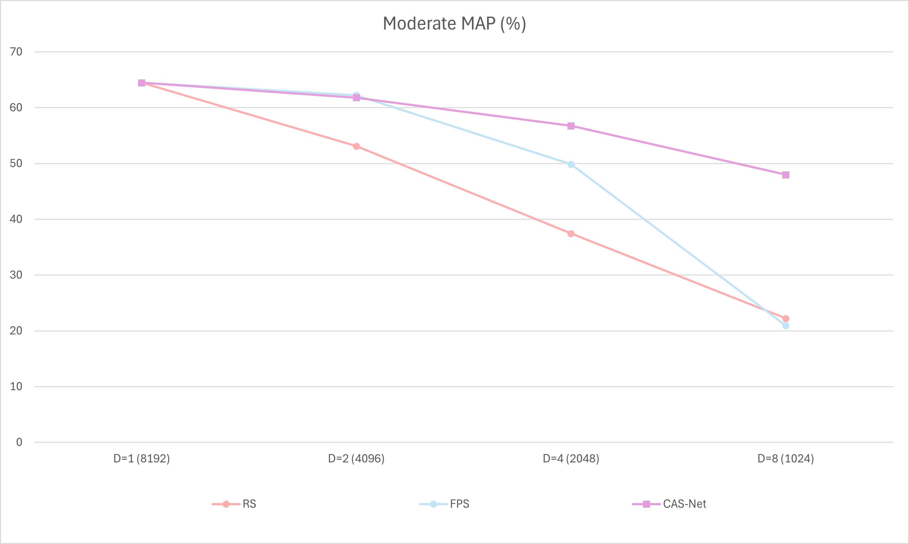
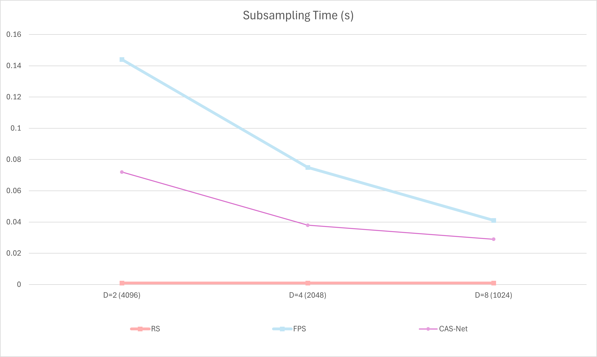

# CAS-Net: Fast Attention-Based Simplification of LiDAR Point Clouds for Object Detection

This project explores ways to improve 3D object detection in LiDAR point clouds by adding a learned sampling step to the PointPillars architecture and comparing it against more traditional sampling approaches.

LiDAR (Light Detection and Ranging) is a rapidly evolving technology that captures the world in precise, high‑resolution 3D point clouds. These datasets are widely used in autonomous driving, robotics, and 3D mapping. However, they often contain millions of points, making them heavy to store, slow to process, and challenging to use in real‑time applications.

A common solution is **point cloud simplification** — reducing the number of points in a way that aims to retain the most relevant geometric and semantic structures. This can significantly improve processing speed and reduce resource usage, while preserving the information needed for tasks like object detection. However, the effectiveness of this process depends heavily on the sampling method used — some techniques prioritize speed, while others focus on maintaining structural integrity.

All experiments in this project are conducted on the well‑known [KITTI dataset](http://www.cvlibs.net/datasets/kitti/), a standard benchmark in autonomous driving research.

---

This work combines two main components:

- **PointPillars** – a 3D object detection architecture that encodes point clouds into a **pseudo-image** representation using **pillars** _(vertical columns on the ground plane)_ without relying on computationally expensive 3D convolutions. Instead, it applies a simplified **PointNet** to learn features from each pillar, followed by an efficient **2D convolutional backbone** and a **single-shot detection head** to predict 3D bounding boxes. This design enables real-time inference at over 60 Hz, significantly outperforming earlier methods in both speed and accuracy, even compared to some sensor fusion approaches. PointPillars is fully end-to-end trainable and well-suited for autonomous driving tasks. ([Paper](https://arxiv.org/pdf/1812.05784), [GitHub](https://github.com/zhulf0804/PointPillars))

- **CAS‑Net** – a *cascade attention-based sampling network*, designed to perform learnable, end-to-end point cloud sampling for downstream tasks like 3D object detection. At its core is the **Attention-based Sampling Module (ASM)**, which jointly considers both geometric structure and semantic relevance to retain the most informative points. The module uses **Offset Attention (OA)** layers to better capture contextual relationships while suppressing redundant or noisy data. CAS‑Net supports both **hard sampling (AHSN)** and **soft sampling (ASSN)** modes. It achieves state-of-the-art performance on benchmarks like ModelNet40 even at high downsampling ratios, while preserving the original shape characteristics of the input cloud. ([Paper](https://ieeexplore.ieee.org/stamp/stamp.jsp?arnumber=10219688), [GitHub](https://github.com/yuanhui0325/CAS-Net))

In **CasNetPointPillars**, CAS‑Net functions as an intelligent, attention-based sampling layer placed before PointPillars. By selecting only the most critical points based on geometry and semantics, it reduces computational load and seeks to maintain _(or even improve)_ overall detection performance.

---

To evaluate performance, three versions of the PointPillars pipeline are tested: one with CAS-Net, one with Random Sampling (RS), and one with Farthest Point Sampling (FPS).

- **Random Sampling (RS)** – selects a fixed number of points completely at random from the cloud. It is extremely fast and simple but can lead to uneven distributions, leaving gaps in some areas while keeping too many points in others, potentially losing important details.
  
- **Farthest Point Sampling (FPS)** – starts with one point and repeatedly chooses the point farthest away from all previously selected points. This produces more uniform coverage and preserves overall shape but is slower and more computationally demanding.


<br>


## Docker Environment (GPU)

To ensure reproducibility, we provide a Docker-based runtime.

**Included files**
- `Dockerfile` — GPU-enabled PyTorch/CUDA environment.
- `build_docker.sh` — builds the image.
- `run_docker.sh` — runs the container with GPU support and mounts the repo + KITTI.

**Usage**
```bash
./build_docker.sh
./run_docker.sh
````

---

## Setup (after Docker is running)

### 1) Build compiled extensions (inside the container)

```bash
sudo su
python setup.py build_ext --inplace
```

### 2) Fix host-side permissions (on the host)

Ensure the repo directory is writable through the mounted volume:

```bash
sudo chmod -R 775 cnpp
```

### 3) KITTI preprocessing (inside the container)

Preprocessing is a two-stage pipeline.

**(a) Reduce LiDAR to camera field-of-view**

```bash
python pre_process_kitti.py --data_root /path/to/kitti
```

`--data_root` must be the KITTI path **as mounted inside the container**.

Outputs:

```
kitti/
├── kitti-reduced_gt_database/
├── training/
│   └── velodyne_reduced/
├── testing/
│   └── velodyne_reduced/
├── kitti-reduced_infos_train.pkl
├── kitti-reduced_infos_val.pkl
├── kitti-reduced_infos_trainval.pkl
├── kitti-reduced_dbinfos_train.pkl
```

**(b) Crop reduced point clouds into n spatial segments**

```bash
python pre_process_kitti_crop.py --data_root /path/to/kitti
```

Outputs:

```
kitti/
├── training/
│   └── velodyne_cropped/
├── testing/
│   └── velodyne_cropped/
├── kitti_infos_train.pkl
├── kitti_infos_val.pkl
├── kitti_infos_trainval.pkl
├── kitti_dbinfos_train.pkl
```

<br>

## Training

Example: **train with CAS-Net** at 1024 points (D=8):

```bash
python train.py --data_root /path/to/kitti --ds_num 1024
```

<details>
<summary><strong>Training arguments</strong></summary>

* `--data_root` (`str`, default: `kitti_data`) — KITTI root path.
* `--saved_path` (`str`, default: `_pillar_logs_tmp`) — output directory for logs/checkpoints.
* `--batch_size` (`int`, default: `8`) — batch size.
* `--num_workers` (`int`, default: `4`) — DataLoader workers.
* `--nclasses` (`int`, default: `3`) — KITTI classes (Car / Pedestrian / Cyclist).
* `--init_lr` (`float`, default: `2.5e-4`) — initial learning rate.
* `--max_epoch` (`int`, default: `160`) — total epochs.
* `--log_freq` (`int`, default: `8`) — logging frequency (steps).
* `--ckpt_freq_epoch` (`int`, default: `20`) — checkpoint frequency (epochs).
* `--resume_epoch` (`int`, default: `0`) — resume from epoch.
* `--ds_num` (`int`, default: `1024`) — number of points retained after sampling.
* `--no_cuda` (flag) — disable CUDA.

</details>

---

## Evaluation

Example: **evaluate CAS-Net** at 1024 points:

```bash
python evaluate.py --data_root /path/to/kitti --ckpt /path/to/checkpoint.pth --ds_mode cn --ds_num 1024
```

<details>
<summary><strong>Evaluation arguments</strong></summary>

* `--data_root` (`str`, default: `kitti_data`) — KITTI root path.
* `--ckpt` (`str`, default: `pretrained/epoch_160.pth`) — checkpoint path.
* `--saved_path` (`str`, default: `_results_tmp`) — output directory for predictions.
* `--batch_size` (`int`, default: `8`) — batch size.
* `--num_workers` (`int`, default: `4`) — DataLoader workers.
* `--nclasses` (`int`, default: `3`) — number of classes.
* `--ds_mode` (`str`, default: `none`) — subsampling mode: `none`, `rs`, `fps`, `cn`.
* `--ds_num` (`int`, default: `1024`) — number of retained points.
* `--no_cuda` (flag) — disable CUDA.
* `--save_ds_pcd` (flag) — save downsampled point clouds + calibration for visualization.

</details>

The trained model checkpoints are available here: [Models](https://drive.google.com/drive/folders/1rhEO7Gw_4f3XaOhS9uhgdojCz6v49mFV)
> Download the desired `.pth` file and pass its path to the `--ckpt` argument.

<br>


## Results (KITTI)

The PointPillars model was evaluated using three different sampling methods — **Random Sampling (RS)**, **Farthest Point Sampling (FPS)**, and **CAS-Net** — across four sampling ratios: **1, 2, 4, and 8**.  Here, **1** represents the baseline with all **8192 points** preserved. 

The complete prediction outputs — including all generated 3D bounding boxes — can be accessed at the following link: [Predictions](https://drive.google.com/drive/folders/1nYSGinl3_bLLn7WvBZROdOXsl49F14vy). This contains the raw detection results for every evaluated frame, which may be useful for further analysis, visualization, or comparison with alternative methods.

### Detection accuracy (bbox_3d, moderate mAP %)

| Method                         | D=1 (8192) | D=2 (4096) | D=4 (2048) | D=8 (1024) |
| ------------------------------ | ---------: | ---------: | ---------: | ---------: |
| RS                             |      64.46 |      53.39 |      37.30 |      22.58 |
| FPS                            |      64.46 |      62.42 |      49.70 |      20.36 |
| **CAS-Net (ours)**             |      64.46 |      61.79 |      56.74 |      47.97 |

<details>
<summary>Chart (accuracy)</summary>



</details>

> **Note:** The tables present only the **overall bbox_3d moderate** scores. The full evaluation results — including all difficulty levels and metrics — are available via the following link: [Full Results](https://drive.google.com/drive/folders/1a-CsqkytRUDGh-Vg3P5ZKgiMLMmz1Nf4)

### Subsampling overhead (seconds per frame)

| Method                         | D=1 (8192) | D=2 (4096) | D=4 (2048) | D=8 (1024) |
| ------------------------------ | ---------: | ---------: | ---------: | ---------: |
| RS                             |          - |      0.001 |      0.001 |      0.001 |
| FPS                            |          - |      0.147 |      0.077 |      0.041 |
| **CAS-Net (ours)**             |          - |      0.071 |      0.036 |      0.028 |

<details>
<summary>Chart (runtime)</summary>



</details>

